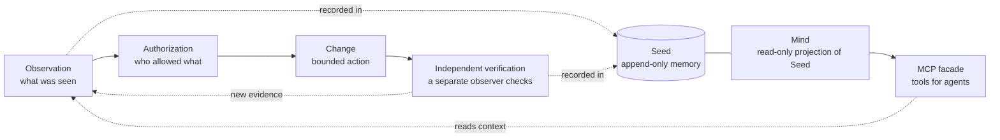

# Integrity Guardian

**An accountability layer and shared mind for teams of AI agents doing real work.**

Coding agents from different vendors can share one memory and one record of
what happened. We run Claude Code, Codex and Antigravity against one core every
day. Cloud agents keep a signed journal that the owner imports as reported
evidence. Live acceptance on a fresh install is not yet published for any vendor.
Every claim keeps its provenance. Every admitted turn ends with a signed close
receipt or a signed coverage gap; turns that skip admission leave no record, and
`integrity-doctor` shows how many. Reading memory never grants authority, so a
plan or a remembered note can never stand in for permission.

**Stable:** [`v7.0.1`](https://github.com/BlackBadHope/Integrity/releases/tag/v7.0.1), Guardian 7.0.0 with memory MCP facade API
2.11.0. The first stable release in this repository was `v7.0.0`; the previous
pre-release is `v7.0.0-beta.4`. Earlier versions were published in a previous repository. Integrity Seats lets each
person use their own model account against one shared core.

**License: [BSL 1.1](LICENSE).** From v7.0.0-beta.4 on, Integrity is under the
[Business Source License 1.1](LICENSE). Production use is free for individuals,
academic and research use, non-profits, and organizations whose group revenue is
below USD 1M. Everyone may evaluate, develop and test with it. Other production
use needs a [commercial license](COMMERCIAL.md). Each version becomes Apache-2.0
four years after its release. Earlier versions, published under Apache-2.0
in a previous repository, keep that license.

## What it does

Each point below is something the repository ships, unless it is marked
*roadmap*.

1. **Evidence ledger (Seed).** Seed is a signed, append-only event log shared
   by agents from every vendor. Each event carries its provenance. Claims stay
   separate from evidence: a record is reported, verified or refuted, and a
   correction is appended next to the claim, never written over it. See
   [ARCHITECTURE.md](ARCHITECTURE.md) and `src/integrity_guardian/seed_*`.
2. **Turn lifecycle with enforcement.** Each admitted turn goes through context
   admission, appends and a signed close. How strictly a client enforces this
   depends on the client; see [the enforcement table](#hooks-where-they-apply-and-what-they-enforce).
   - **Admission-first gate.** It denies other tools until admission. It is on by
     default in generated Claude Code profiles on Linux and opt-in elsewhere
     (`"admission_first": "block"` in `turn-guard.json`). The Claude Code Native
     route on Windows has no gate. Without the gate, a model
     can skip admission.
   - **Unclosed turns.** Where the client can block, a turn that changed state
     without closing its record is blocked once, then recorded as coverage debt.
   - **Health.** `integrity-doctor` reports hook health. See
     [hooks troubleshooting](docs/hooks-troubleshooting.md).
3. **Authority separation (Guardian).** A memory read never grants power.
   Actions need signed, one-use grants, and the owner's approval is a separate,
   explicit step. See `src/integrity_guardian/authority_scope.py` and
   `intent_custody.py`.
4. **Mind graph.** Mind is a read-only projection of Seed: tasks, goals,
   roadmap items, facts, contradictions and stale assertions. Each admitted turn
   receives a bounded capsule from it, with plan items when they fit the byte
   budget. See
   `src/integrity_guardian/mind_*`.
5. **Coordination.** Agents can declare the blast radius of a write, and
   overlapping claims are fenced between processes on one machine. Hooks do not
   force a declaration. A seat-scoped bus and mesh claims help several vendors
   share one infrastructure. See
   `src/integrity_guardian/work_claims.py`,
   [team quickstart](docs/QUICKSTART_TEAM.md) and
   [`integrity-llm-bus`](components/integrity-llm-bus/README.md).
6. **Procedural memory (Uroboros).** Verified work becomes a reusable
   route. At admission an Action Log from beta.4 or later offers up to three matching routes in the capsule, as hints that are
   never authority. This works server-side for any client and Seed, including
   routes observed in existing history; we have checked it live with Claude Code
   ([Uroboros](docs/UROBOROS.md)). The signed Toolzs protocol
   (`src/integrity_guardian/uroboros_toolzs_*`) is still an alpha library.
   Agents record, check and repair routes with
   `python -m integrity_guardian.uroboros_routes`.
7. **Reach.** The core runs on the local machine, or across machines over an
   OpenSSH forced command ([two-machine quickstart](docs/CROSS_MACHINE_QUICKSTART.md)).
   Cloud agents keep signed journals that the owner imports offline as reported
   evidence (CI-tested; no live Codex Cloud acceptance yet; see
   [cloud agents](docs/CLOUD_AGENTS.md)). We have also run Codex and Claude Code on
   an Android phone (tested once, no guide yet; see [Use cases](#use-cases)).
8. **Home.** `integrity-home` is an optional private archive and projection,
   kept apart from project memory: Home data never becomes Seed data
   automatically. See [its README](components/integrity-home/README.md).

## Who we are and why

Integrity is built and used every day in the production operations of a small
internet service provider. One operator runs it. Agents from Anthropic (Claude
Code), OpenAI (Codex) and Google Antigravity write to the same core from a
Windows workstation, a Linux server and an Android phone. The project's own log
holds about 8,800 events.

It started as a fix for a simple problem: every agent forgot everything between
sessions and knew nothing about what the others had done. Vendor harnesses now
have their own memory, session resume and project instructions. Integrity
complements them with what one vendor's memory does not try to do:

- one append-only log shared across vendors, with provenance on every event;
- claims kept apart from evidence, so a report stays a report until something
  verifies it;
- hooks that check the record at every turn and, where the client allows it,
  stop a turn that did not close it.

## What's new

[`v7.0.1`](https://github.com/BlackBadHope/Integrity/releases/tag/v7.0.1) gives models smaller memory responses: an admission
through the Antigravity broker shrinks from about 24 KB to 4–6 KB, and an append
receipt from 4–116 KB to about 0.5 KB in every broker (see
[RELEASE_NOTES.md](RELEASE_NOTES.md)). [`v7.0.0`](https://github.com/BlackBadHope/Integrity/releases/tag/v7.0.0) was the first stable
release in this repository. Since beta.4, the model's broker opens the turn registration itself, right after
admission (in the owner's Windows deployment of the same change, the median
admission went from 45 s to 15 s), and every claim on this page was checked against evidence.
[`v7.0.0-beta.4`](https://github.com/BlackBadHope/Integrity/releases/tag/v7.0.0-beta.4) added the admission-first gate (on by default for
Claude Code profiles on Linux), Antigravity fixes from live use, known runbook
routes at admission, and the Business Source License 1.1. See
[RELEASE_NOTES.md](RELEASE_NOTES.md). The items below came in
beta.2 and beta.3, which were developed in a previous repository; pull request
numbers refer to it.

- **Hooks enforce the turn close**
  (PR #49, beta.3). The
  `Stop` hook blocks, once, a turn that changed state without closing its
  memory record. The next stop records a coverage gap, so a turn cannot loop.
  A live test of beta.3 found gaps, for example a notification inside a turn
  could drop the guard. beta.4 fixes them.
- **Honest status messages** (PR #49, beta.3; completed in beta.4). In beta.3 a
  cold broker start could still time out the probe and show a false
  `MEMORY UNREACHABLE`. beta.4 waits up to 50 s and treats a timeout as
  inconclusive.
  `MEMORY UNREACHABLE` appears only when a probe or the broker start really
  failed. `ADMISSION SKIPPED` means the server answered and the model did not
  call it. Together they replace the old "memory offline" guess.
- **`integrity-doctor`** (PR #49, beta.3).
  A read-only check: where hooks are installed and their scope, whether the
  memory server answers, and recent close coverage. beta.4 fixes its
  "blocked once" count and reads settings files that start with a UTF-8 BOM. See
  [hooks troubleshooting](docs/hooks-troubleshooting.md).
- **Cloud-agent journal** (`integrity-cloud`,
  PR #40, beta.2).
  Agents that cannot run local hooks keep a signed turn journal in their
  sandbox. The host verifies it before importing it as reported evidence. See
  [cloud agents](docs/CLOUD_AGENTS.md).
- **Cross-machine Live** (`integrity-remote`,
  PR #37, beta.2).
  Client machines reach one core over an OpenSSH forced command. CI tests
  host-key pinning and key revocation. See the
  [two-machine quickstart](docs/CROSS_MACHINE_QUICKSTART.md).
- **Linux native profiles** for Codex and Claude Code
  (PRs #38 and #39,
  beta.2).
- **Mobile Codex (DroidDeck)**: Codex on an Android phone, in a Linux userland,
  writes to the same core over SSH. Getting it there exposed real bugs.
  PR #43 (beta.2) fixes
  two of them: Codex hooks without `CODEX_THREAD_ID`, and sandboxes that refuse
  hard links.

The full list is in [CHANGELOG.md](CHANGELOG.md) and
[RELEASE_NOTES.md](RELEASE_NOTES.md).

## Use cases

Each case is marked with how far it has been checked:

- **daily use**: we run it in our own operations;
- **CI-tested**: public CI covers it;
- **tested once**: a recorded manual run;
- **roadmap**: not in this repository yet.

### Windows desktop: Claude Code, Codex, Antigravity

*Claude Code: daily use, through the standalone hook. Codex: in regular use; on
Windows through managed hooks that have no turn guard. Antigravity lifecycle
hooks: CI-tested, and tested live with a Claude model.*
`integrity-native-profile` generates the MCP registration and lifecycle hooks
for each client. The [native onboarding guide](docs/native-onboarding.md)
walks through install, connection, expected hook behavior and rollback.

Before you start, know what a new installation needs:

- **A memory server you operate.** Every hook profile connects to your own
  Integrity Memory instance, with its trust bootstrap and Action Log witness.
  A source checkout is not one. See the onboarding prerequisites. The
  read-only walkthrough below needs no server.
- **Codex and Antigravity** profiles build on a fresh Windows checkout.
  `native_runtime verify` and `probe` pass on the generated Codex profile. This
  was checked on a fresh clone on a development machine; the clean-VM result for
  7.0.0 is in [RELEASE_NOTES.md](RELEASE_NOTES.md).
- **Claude Code** Native profiles on Windows work only through the enrolled
  publisher route. A plain Claude Code install is refused with "requires its
  actual enrolled session ID". Our own Claude Code sessions use the standalone
  hook (`resources/claude/admission.py`), wired into a project
  `.claude/settings.json` by hand. There is no one-command install for it yet.
- **Hooks are project-scoped.** A session started in another folder runs
  without memory. `integrity-doctor` reports this. To try
memory first without hooks, use the read-only
[local-memory walkthrough](examples/local-memory/README.md). CI runs it
on Linux and Windows, and it prints PASS for all three clients.

### Linux workstations and servers

*CI-tested. Also run on a clean Debian VM (beta.3).* Codex and Claude Code Native
profiles run under user custody. See
[Linux native clients](docs/linux-native-clients.md):

```bash
python3 -m venv ~/.local/share/integrity/venv
~/.local/share/integrity/venv/bin/python -m pip install . ./components/integrity-action-log './components/integrity-client-memory[native]'
```

### Android phone (DroidDeck)

*Tested once; no guide in this repository yet.* DroidDeck is our Android
setup: a Linux userland on the phone. On it, the Codex CLI writes to the same
core over the SSH forced command described below. Claude Code also runs there
with Remote Control, so a prompt sent from claude.ai ran on the phone. Two
things we learned:

- Use the musl native Claude Code build. The glibc build aborted under the
  userland's preloaded library.
- Hard links are refused in that sandbox. Client Memory handles this since beta.2.

### CLI and headless agents

*Tested once.* A headless `claude -p` run in a project folder uses that
project's hooks. In a four-turn check on beta.3:

- admission worked;
- a read-only turn closed with `no-event`;
- a shell turn without a close was blocked once, then ended with the gap
  recorded;
- after two turns without admission the notice said `ADMISSION SKIPPED`.

Hooks are project-scoped by default. See
[where hooks apply](docs/hooks-troubleshooting.md#where-the-hooks-apply).

### Cloud agents (Codex Cloud)

*CI-tested; no live Codex Cloud acceptance yet.* An agent that cannot run local
hooks keeps a signed turn journal in its sandbox and commits it with its work.
The host verifies the chain before importing it as reported evidence, so no
inbound access to your network is needed. See
[cloud agents](docs/CLOUD_AGENTS.md) and the setup script
`examples/cloud-agents/codex-cloud-setup.sh`.

### Cross-machine: core on one machine, clients on another

*CI-tested and in daily use.* `integrity-remote` connects a client machine to
the core over an OpenSSH forced command with a pinned host key. CI tests
unknown-key denial, key revocation and lifecycle parity between local and SSH
clients. See the [two-machine quickstart](docs/CROSS_MACHINE_QUICKSTART.md).

### A multi-vendor team on one infrastructure

*Daily use.* This is our own setup: one operator, and agents from Claude Code
and Codex, with Antigravity in live tests, working on the same ISP infrastructure. In daily use the
agents hand tasks to each other through a local bus. When one vendor hit a
quota, another continued from the same log. See the
[team quickstart](docs/QUICKSTART_TEAM.md).

### Event-driven runbooks

*Roadmap.* The plan is for an infrastructure event, such as a syslog line,
to start an agent turn that follows a verified runbook route. With an
up-to-date Action Log, known routes reach every admitted turn, including turns
that a hook starts ([Uroboros](docs/UROBOROS.md)). The hooks themselves are deployment-specific.

## What it is and why

AI agents and scripts now read logs, remember past work and change real
systems. It is easy to mix those up: a remembered note looks like a fact, a
model's plan looks like permission, and a "200 OK" looks like the job is done.
Integrity Guardian keeps a signed, append-only record that holds those apart,
so a person or another tool can later check what happened and who allowed it.



- **Seed** is the append-only event log. It remembers; it never grants authority.
- **Mind** is a read-only view built from Seed (tasks, links, contradictions).
- **The MCP facade** exposes Seed and Mind to agents as tools, so an agent gets
  context and can append records, but a memory read is never a permission.

Integrity Guardian is a local-first integrity layer for humans, automation and
AI agents. It keeps four questions separate:

1. What was observed?
2. What action was authorized?
3. What actually changed?
4. Can an independent observer verify the outcome?

That separation prevents memory, model output or a successful request from
being mistaken for truth, permission or completion.

## Current status

This repository contains one canonical Guardian runtime and 17 optional Python
distributions. [COMPONENTS.json](COMPONENTS.json) records their independent
versions, dependencies, import namespaces and entrypoints. Source for local
archives, memory delivery, agent transports and the UI is included; user data,
credentials, enrolled sessions, host bindings and retained operational evidence
are not. Tests use synthetic inputs. Integrity source is licensed under the
Business Source License 1.1 from v7.0.0-beta.4 on (see [License](#license)); bundled
third-party code keeps its own [license notices](LICENSES.md).

Installation does not silently connect to somebody else's infrastructure.
Configure the included adapters with authority and credentials belonging to
your own machine or environment. Target-specific route aliases are not part of
the public core; supply your own route catalogue when needed.

## Prerequisites

- Git and Python 3.11 or newer. Node.js 18+ with npm is optional and only
  needed for the `integrity-space` UI tests.
- Debian/Ubuntu ship `python3` without a `python` alias and without venv or
  pip. Install them first, then create the virtualenv with `python3`:

  ```bash
  sudo apt install git python3 python3-venv python3-pip bubblewrap
  ```

  `bubblewrap` is the Linux sandbox the test suite uses. Inside an activated
  virtualenv, `python` works on every platform.
- Create the virtualenv **outside** the clone, as the commands below do
  (`../integrity-venv`). The public surface check scans the whole tree and
  fails on a `.venv` inside it.

## Public beta quickstart

Integrity Seats **7.0.1** is a source release under the
[Business Source License 1.1](LICENSE), tagged as the GitHub release `v7.0.1`.
It is not a production deployment. Mode B tunnels are unverified, and macOS has known
failures (see [Platform support](#platform-support)). Cross-machine memory
(core on machine A, clients on machine B) runs over an OpenSSH forced command:
see the [two-machine quickstart](docs/CROSS_MACHINE_QUICKSTART.md) for what is
tested and what is not. To roll back, check out `v7.0.0`, and keep your existing install until the new one passes your
checks. Details are in [RELEASE_NOTES.md](RELEASE_NOTES.md).

From a new clone, create a virtualenv, install Guardian, then install the
seats console from `integrity-home`:

```bash
git clone https://github.com/BlackBadHope/Integrity.git
cd Integrity
python -m venv ../integrity-venv
```

To build exactly this release instead of current `main`, run
`git checkout v7.0.1` after `cd Integrity`.

Activate it (Linux/macOS: `. ../integrity-venv/bin/activate`, Windows
PowerShell: `..\integrity-venv\Scripts\Activate.ps1`), then:

```bash
python -m pip install --upgrade pip
python -m pip install .
python -m pip install ./components/integrity-home
guardian version --all
```

`guardian version --all` reports the public source profile for version 7.0.0.
These commands do not enroll a host. Run the read-only MCP walkthrough in
disposable directories outside the checkout. Each configuration should print
PASS:

```bash
CASE="${TMPDIR:-/tmp}/integrity-beta-case"
CLIENTS="${TMPDIR:-/tmp}/integrity-beta-clients"
python -B examples/local-memory/create_case.py --output "$CASE"
python -B examples/local-memory/setup.py --catalog "$CASE/private/catalog.sqlite" --output "$CLIENTS"
python -B examples/local-memory/verify_connection.py "$CLIENTS/codex.config.toml" "$CLIENTS/claude.mcp.json" "$CLIENTS/antigravity.mcp.json"
```

Then follow the [team quickstart](docs/QUICKSTART_TEAM.md) (CI-tested with
synthetic seats). `integrity-seats`
comes from the `integrity-home` install above. Global options belong before
the subcommand.

The quickstart does not install pytest or the components. Before running any
test command, follow [Run the test suite](#run-the-test-suite): it installs
pytest and the build tools, then builds and installs every component into a
separate virtualenv. Running pytest straight after the quickstart fails with
`No module named pytest`.

## Hooks: where they apply and what they enforce

Memory reaches a model only through client hooks, so check them before trusting
a session:

- **Scope.** `integrity-native-profile` generates project-scoped hook files
  (`.claude/settings.json`, `.codex/hooks.json`) and prints that scope. A
  session started in any other folder runs without Integrity memory. To cover
  every folder, merge the hooks into `~/.claude/settings.json` or
  `$CODEX_HOME/hooks.json` by hand. This is tested on Linux; there is no command
  for it yet.
- **Enforcement.** Where a client can block, the `Stop` hook blocks a turn
  once if it changed state (edits, shell, MCP writes) without calling
  `integrity_turn_memory_close`. The next stop always ends the turn and records
  the coverage gap, so a turn cannot loop.
  - Notification and peer-event turns are exempt. Work a peer message asks for
    therefore runs without the guard.
  - Read-only turns may close with `no-event`.
  - What each client does:

  | Client | Missing close | Admission-first gate |
  | --- | --- | --- |
  | Claude Code, standalone hook (wired by hand) | blocked once with `block`; `advise` (report only) unless `turn-guard.json` says `block` | opt-in |
  | Claude Code Native on Linux | advise only: the Native head is already closed when `Stop` runs | on by default |
  | Claude Code Native on Windows (enrolled publisher) | not blocked: this route has no turn guard; an unclosed registration stays a coverage gap | not available |
  | Codex Native on Windows | blocked once (profile default `block`; no live Codex run of it yet) | opt-in |
  | Codex Native on Linux | advise only, by design | opt-in |
  | `integrity-seats` plugin hooks | blocked once (launcher default `block`) | opt-in |
  | Antigravity | recorded as a gap; Antigravity's `Stop` cannot block | opt-in; when on, admitted turns auto-approve the standard tools |
  | Cloud agents | no hooks; a signed journal is imported as reported evidence | — |

  The off switches:
  - `INTEGRITY_TURN_CLOSE_ENFORCEMENT=off`, or `{"enforce_turn_close": "off"}` in
    `turn-guard.json`, turns off the close guard.
  - `INTEGRITY_ADMISSION_FIRST=off`, or `{"admission_first": "off"}`, turns off the
    gate.
  - `integrity-native-profile --admission-first block|off` chooses the gate at
    build time.
- **Known Antigravity limits.** Gemini Flash models may ignore MCP tool calls,
  so their turns get no memory. With the gate on, their other tools stay denied.
  Through `agentapi`, `new-conversation` creates owner turns for any local
  process that holds the hub CSRF token.
- **Diagnosis.** `integrity-doctor` shows where hooks are installed, whether
  the memory server answers, and the admission/close coverage of the last turns.

[Hooks troubleshooting](docs/hooks-troubleshooting.md) explains each mode and
the difference between "memory unreachable" and "admission skipped".

## Known limitations

- Live acceptance with a model on a fresh install is not yet published for any
  vendor.
- macOS is not supported yet: the informational CI job has known failures.
- Mode B tunnels are unverified.
- Hooks are project-scoped unless you merge them into user settings by hand.
- The Claude Code Native route on Windows has no turn guard and no
  admission-first gate. Antigravity's `Stop` cannot block. On Linux the guard
  only advises.
- Gemini Flash models in Antigravity may skip memory entirely (see above).
- Cloud agents do not share memory live. Their signed journals are imported as
  reported evidence.

## Who should try it

Integrity Guardian is for developers and operators building AI agents,
automation or evidence-sensitive workflows who need to distinguish an observed
fact, an authorized action and a verified outcome. It is intended for real use
and testing on user-owned machines. Reports from different operating systems,
agent stacks and external targets are the main purpose of this public project.

## Try it in five minutes

To connect a first local memory catalog to Codex, Claude Code or Antigravity,
use the [read-only MCP walkthrough](examples/local-memory/README.md). It includes
complete configuration generation, an independent protocol check and, as a
manual step that needs a model, a configuration-recall example with a plain-note
control. Native lifecycle hooks
remain a separate deployment.

Install the current `main` source. Record the checked-out commit when reporting
a result:

```bash
git clone --depth 1 https://github.com/BlackBadHope/Integrity.git
cd Integrity
git rev-parse HEAD
python -m venv ../integrity-venv
```

Activate `../integrity-venv` using the command for your shell, then run:

```bash
python -m pip install .
guardian version --all
guardian platform-profile
```

Create a disposable demo directory outside the checkout:

```bash
python -c "import tempfile; print(tempfile.mkdtemp(prefix='integrity-demo-'))"
```

Change into the printed directory. Create a deliberately unordered JSON
observation and ask Guardian for its canonical representation and
domain-separated digest:

```bash
echo '{"b":2,"a":1}' > observation.json
guardian canonicalize observation.json
guardian digest demo observation.json
```

Expected output:

```text
{"a":1,"b":2}
sha256:642c2d4d9286b31e56f6090f47b0435de8b034e713fe160d5ba51457138954b8
```

This first exercise does not create or modify Integrity state. Delete the
temporary demo directory when finished, then return to the checkout. Continue with the
[clean bootstrap guide](BOOTSTRAP.md) when you are ready to create an isolated
local instance.

## Install from source

Linux and Windows users need Python 3.11 or newer; CI runs 3.11 and 3.12 on both.
macOS is not supported yet (see [Platform support](#platform-support)).
See also [Prerequisites](#prerequisites):

```bash
git clone https://github.com/BlackBadHope/Integrity.git
cd Integrity
python -m venv ../integrity-venv
```

Activate the environment:

```bash
# Linux/macOS
. ../integrity-venv/bin/activate

# Windows PowerShell
..\integrity-venv\Scripts\Activate.ps1
```

Install Guardian and inspect the local profile:

```bash
python -m pip install .
guardian version --all
guardian capabilities
guardian lts-contracts
```

`version --all` reports the public source profile. These commands do not enroll
a host or grant action authority. Continue with [BOOTSTRAP.md](BOOTSTRAP.md) to
select optional components and, separately, initialize your own local state.

## Components

All distributions require Python 3.11 or newer. Their versions describe
different interfaces and deliberately do not all match the Guardian version.

| Distribution | Version | Purpose |
| --- | --- | --- |
| `integrity-guardian` | 7.0.0 | Canonical protocol, evidence, authorization and memory core |
| [`integrity-adapter-sdk`](components/integrity-adapter-sdk/README.md) | 2.0.0rc3 | Guardian-bound adapter facade |
| [`integrity-execution-bridge`](components/integrity-execution-bridge/README.md) | 0.1.0rc5 | Verified execution and observation boundaries |
| [`integrity-agents-api`](components/integrity-agents-api/README.md) | 0.1.0rc2 | Agent API integration |
| [`integrity-codex-persistent`](components/integrity-codex-persistent/README.md) | 0.1.0rc3 | Persistent Codex adapter |
| [`integrity-active-inquiry`](components/integrity-active-inquiry/README.md) | 0.1.0rc2 | Bounded active inquiry |
| [`integrity-experience-adapters`](components/integrity-experience-adapters/README.md) | 0.1.0rc3 | Experience adapter interfaces |
| [`integrity-resource-advisor`](components/integrity-resource-advisor/README.md) | 0.1.0rc6 | Local resource and usage projections |
| [`integrity-action-log`](components/integrity-action-log/README.md) | 2.11.0 | Action Log HTTP service and read-session evidence |
| [`integrity-memory-plane`](components/integrity-memory-plane/README.md) | 1.0.0 | Catalog synchronization, retention and storage tools |
| [`integrity-client-memory`](components/integrity-client-memory/README.md) | 1.13.1 | Codex, Claude and Antigravity hook/broker profiles |
| [`integrity-home`](components/integrity-home/README.md) | 0.2.0a1 | Home archive and Chronicle projections |
| [`integrity-space`](components/integrity-space/README.md) | 0.2.0 | Read-only MCP Apps lab and workbench UI |
| [`integrity-claude-code`](components/integrity-claude-code/README.md) | 0.1.0rc3 | Separately guarded Windows CLI executor |
| [`integrity-llm-bus`](components/integrity-llm-bus/README.md) | 1.0.0 | Local queue, registry, relay and steering transports |
| [`integrity-bridges`](components/integrity-bridges/README.md) | 0.7.0 | Hub, delegation and native peer transports |
| [`integrity-remote`](components/integrity-remote/README.md) | 0.1.0b1 | Cross-machine core access over an OpenSSH forced command |
| [`integrity-cloud`](components/integrity-cloud/README.md) | 0.1.0b1 | Signed turn journals for cloud agents without local hooks |

`components/integrity-seed` and `plugins/` also retain their specific plugin
interfaces; they are not extra Python distributions. The Codex registration
template is [Integrity Seats](plugins/integrity-seats/README.md). Historical
source-profile metadata is documented in the
[source layout](components/integrity-installed-runtime/README.md).

## Run the test suite

Public CI (`.github/workflows/public-surface.yml`) runs these checks on Ubuntu
and Windows with Python 3.11 and 3.12, plus an informational macOS job. Linux CI also installs `bubblewrap`. Reproduce
them from the root of a clean clone: a source install (`pip install .` or
`./components/...`) leaves `*.egg-info` build files that the surface check
rejects, so check a fresh `git clone` of your commit as CI does. Use a new
disposable directory for build output;
the examples below use `$TMPDIR` or `/tmp` and do not read retained state.

```bash
python -m pip install "build>=1.2,<2" "packaging>=24,<27" "pytest>=8.2,<10"
python .github/scripts/public_surface_check.py --root .
python .github/scripts/component_catalog.py --root .
python components/integrity-installed-runtime/verify_sources.py
python -B components/integrity-seed/verify_public_surface.py
OUT="${TMPDIR:-/tmp}/integrity-dist"
python .github/scripts/build_components.py --root . --output "$OUT"
python .github/scripts/verify_wheels.py --root . --wheels "$OUT"
python .github/scripts/install_components.py --wheels "$OUT" --venv "${TMPDIR:-/tmp}/integrity-check"
```

Activate that virtual environment. CI appends its `bin` directory to `PATH`
instead. You do not need to `deactivate` the quickstart venv first, because
activating another venv replaces it.

```bash
. "${TMPDIR:-/tmp}/integrity-check/bin/activate"            # Linux, macOS
# . "${TMPDIR:-/tmp}/integrity-check/Scripts/activate"      # Windows, Git Bash
```

Then run the installed profile, the public tests, the local MCP walkthrough,
component tests, and the shipped UI models:

```bash
guardian version --all
guardian capabilities
guardian lts-contracts
python -B -m pytest -q -p no:cacheprovider
CASE="${TMPDIR:-/tmp}/local-memory-case"
CLIENTS="${TMPDIR:-/tmp}/local-memory-clients"
python -B examples/local-memory/create_case.py --output "$CASE"
python -B examples/local-memory/setup.py --catalog "$CASE/private/catalog.sqlite" --output "$CLIENTS"
python -B examples/local-memory/verify_connection.py "$CLIENTS/codex.config.toml" "$CLIENTS/claude.mcp.json" "$CLIENTS/antigravity.mcp.json"
python -B -m pytest -q -p no:cacheprovider --import-mode=importlib components/*/tests
```

From `components/integrity-space`, run `npm test`. Root pytest includes
`tests/hygiene/test_public_export_hygiene.py`.

On Linux the Native client-memory profiles run rather than skip. The remaining
Linux skips are platform-absent tools (PowerShell), other vendors' parametrised
cases, Windows cmd-launcher specifics that have POSIX counterparts, and one
static-analysis limit. Linux CI fails on any client-memory skip outside the
reviewed list (`.github/scripts/native_skip_guard.py`); skips in other suites
are not guarded. See
[Native lifecycle hooks on Linux](docs/linux-native-clients.md). The
[expected test skips](docs/expected-test-skips.md) page lists the expected
skips per platform, measured in CI, so you can tell a normal run from a broken
one.

These checks verify the closed export manifest, component metadata, canonical
source layout, package builds and dependency compatibility, CLI smoke commands
and synthetic functional tests. See
[architecture and verification boundaries](ARCHITECTURE.md#what-the-public-suite-verifies).

## Cloud agents

Cloud agents such as Codex cloud tasks cannot run the local hooks that open and
close Integrity turns. [`integrity-cloud`](components/integrity-cloud/README.md)
lets them keep the same signed turn journal inside their container:

- a fresh key for each task;
- turn receipts;
- `--kind action` records for external changes;
- a sealed bundle committed with the work.

Nothing is sent over the network. The owner verifies the bundle offline and
imports it as **reported** memory. Setup for a Codex cloud environment, the
threat model and the planned append-only ingress are in
[docs/CLOUD_AGENTS.md](docs/CLOUD_AGENTS.md).

## How it fits together

```text
observation -> signed evidence -> proposed action -> prior authority
            -> bounded execution -> independent observation -> replay
```

- **Guardian Core** validates identities, signed evidence and lifecycle rules.
- **Seed** provides append-only memory without turning memory into authority.
- **Adapters** establish explicit capabilities at an external boundary.
- **Observers** verify outcomes independently from the actor that requested them.

Start with the [clean bootstrap guide](BOOTSTRAP.md), then review the
[architecture map](ARCHITECTURE.md), [security guidance](SECURITY.md), the
[roadmap](ROADMAP.md) and [contribution guide](CONTRIBUTING.md).

### Verified scope

The public suite verifies the protocol core, the Ledger, one-use
ChangeIntent custody, index-backed Seed queries and fenced blast-radius
claims between processes **on one machine**. An end-to-end test enrolls two
machines and rejects a stale fence (`tests/e2e/test_two_machine_mesh.py`).
General coordination across machines, authenticated agent identity for claims
and production operation are not claimed; [ARCHITECTURE.md](ARCHITECTURE.md) lists each boundary.

## Platform support

| Platform | Source/install | Public CI | Operational integration |
| --- | --- | --- | --- |
| Linux | Supported | Python 3.11 and 3.12, full suite | Requires an independently configured adapter |
| Windows | Portable core and client hooks supported | Python 3.11 and 3.12, full suite (about 130 platform skips) | POSIX-only custody and Windows-only executors have separate gates |
| macOS | Not supported yet | Informational job: core and client-memory run, with known failures | Linux procfs custody (Toolzs authority ledger, Seed runtime recovery) does not work on macOS |

Platform support is a capability vector. An installation PASS does not imply
that host binding, credentials or production actions are configured.

- The portable core is verified on Python 3.11 and 3.12 in public CI, and on
  Python 3.12 in an independent clean-machine run.
- On macOS the informational CI job shows about 50 failing tests in the core
  suite and 55 in client-memory. Most need Linux `/proc` custody
  (`uroboros_toolzs_authority_ledger`, Seed sync and runtime recovery). Until
  they are ported, macOS is not a supported platform.
- The optional local adversarial rehearsal reported by `guardian
  platform-profile` needs `bubblewrap`, `prlimit` and a `python3.14`
  executable on `PATH`. Without them the profile reports
  `prerequisite-missing`; the rest of Guardian does not need them.
- Inside a nested Docker container, bubblewrap usually cannot create a user
  namespace. That is a limit of the container, not of Integrity: the
  sandboxed tests fail or skip there, and they pass on a host or VM.

## Project policy

- [Installation and bootstrap](BOOTSTRAP.md)
- [Architecture and verified scope](ARCHITECTURE.md)
- [Security policy](SECURITY.md)
- [Contributing](CONTRIBUTING.md)
- [Roadmap](ROADMAP.md)
- [Changelog](CHANGELOG.md)
- [Public export boundary](PUBLIC-EXPORT-NOTICE.md)

Report security issues privately, not in a public issue: open an issue titled
"Security contact" with no details, and the maintainer opens a private security
advisory with you.

Questions, use-case proposals and first-user feedback are welcome in
the repository's **Discussions** tab.
Reproducible defects belong in the repository's **Issues** tab.

## License

Copyright 2026 Ilia Pikalov and Integrity Project contributors.

- **From v7.0.0-beta.4 on:** the [Business Source License 1.1](LICENSE).
  - Everyone may copy, modify and redistribute it, and use it for evaluation,
    development and testing.
  - Production use is free for individuals, academic and research use,
    non-profits, and organizations whose annual gross revenue, together with all
    their Affiliates (more than 50% control), is below USD 1,000,000.
  - Other production use needs a [commercial license](COMMERCIAL.md).
  - Each version changes to the Apache License 2.0 four years after its release.
- **Earlier releases:** 6.1.1 and 7.0.0-beta.1 to 7.0.0-beta.3 were published
  under the Apache License 2.0 in a previous repository. Copies obtained under
  that license keep it.
- **Contributions:** they need a signed [CLA](CLA.md).

See [LICENSES.md](LICENSES.md) for bundled third-party notices and external
dependency boundaries.

## Runtime source reference

[The canonical source layout](components/integrity-installed-runtime/README.md)
replaces former copied kernel trees with one maintained implementation per
namespace. Historical version matrices remain reference metadata, not active
package versions or evidence of a deployment.

## Installation acceptance evidence

See the historical [6.1.0 / 6.1.1 isolated installation report](docs/audits/installation-6.1.1-20261017/REPORT_RU.md) for Linux and Windows results, single-run command timings, preserved failures, limitations and evidence SHA256. These timings are not product-performance or cross-platform speed claims.

For complete Native admission, append, closure and vendor lifecycle hook wiring,
use the [Native onboarding guide](docs/native-onboarding.md). It includes generated
private profiles, exact Native ownership prerequisites, paused-vendor historical
evidence boundaries and rollback. Linux user-custody profiles are described in
[Native lifecycle hooks on Linux](docs/linux-native-clients.md).
