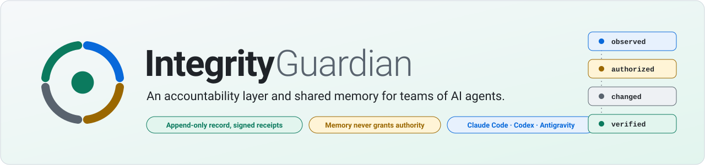
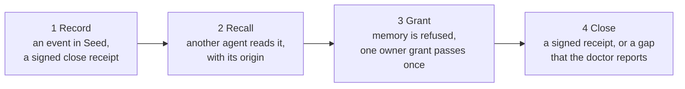
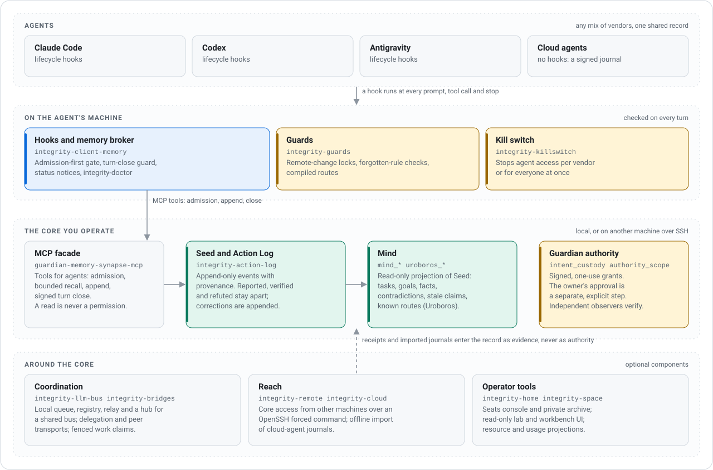
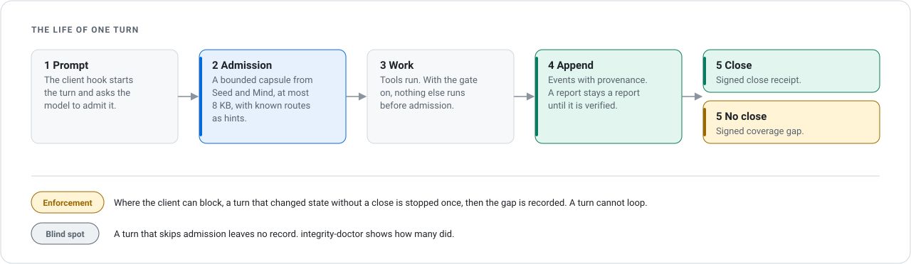
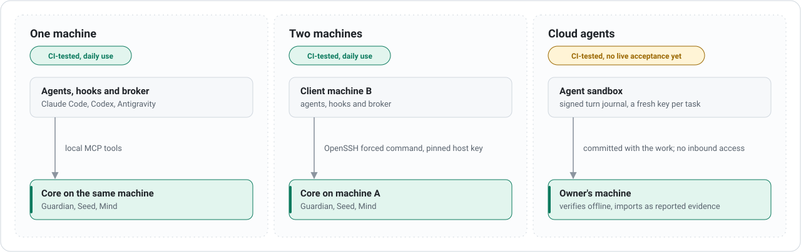

<p align="center">
  <picture>
    <source media="(prefers-color-scheme: dark)" srcset="docs/assets/banner-dark.svg">
    
  </picture>
</p>

<p align="center">
  <picture>
    <source media="(prefers-color-scheme: dark)" srcset="docs/assets/demo-dark.svg">
    
  </picture>
</p>

<p align="center"><sub>
  Recorded from <a href="demo/run.py"><code>demo/run.py</code></a>: one machine, synthetic data, no network, no account.
  Repeat it yourself after the <a href="#quick-start">install</a>: <code>python demo/run.py</code> ·
  <a href="#the-demo-step-by-step">what each scene runs</a>
</sub></p>

<p align="center">
  <a href="https://github.com/BlackBadHope/Integrity/releases/tag/v7.0.1"></a>
  <a href="LICENSE"></a>
  
  
</p>

<p align="center">
  <a href="#quick-start"><b>Quick start</b></a> ·
  <a href="#how-it-works"><b>How it works</b></a> ·
  <a href="#components"><b>Components</b></a> ·
  <a href="docs/STATUS.md"><b>What is verified</b></a> ·
  <a href="docs/README.md"><b>Documentation</b></a> ·
  <a href="CHANGELOG.md"><b>Changelog</b></a>
</p>

# Integrity Guardian

Coding agents from different vendors can share one memory and one record of
what happened. We run Claude Code, Codex and Antigravity against one core every
day. Every claim keeps its provenance. Every admitted turn ends with a signed
close receipt or a signed coverage gap. Reading memory never grants authority,
so a plan or a remembered note can never stand in for permission.

This page says only what the repository ships. Where something is not verified,
it says so; [what is verified](docs/STATUS.md) has the full list.

## Why

AI agents now read logs, remember past work and change real systems. Three
mix-ups follow:

| It looks like | It is | What Integrity does |
| --- | --- | --- |
| a fact | a remembered note | keeps the claim apart from the evidence, with provenance on both |
| permission | a model's plan | grants authority only through a signed, one-use grant and the owner's explicit approval |
| a finished job | a `200 OK` | lets an independent observer verify the outcome |

So Integrity keeps four questions separate, for people, scripts and agents
alike:

| 1. Observed | 2. Authorized | 3. Changed | 4. Verified |
| --- | --- | --- | --- |
| What was seen? | Who allowed what? | What actually changed? | Can someone else check it? |

## The demo, step by step

The picture at the top is the output of [`demo/run.py`](demo/run.py). After the
[quick start](#quick-start) install, run it from the clone:

```bash
python demo/run.py
```

It needs no network, no account and no model. It writes to a temporary
directory and removes it.



| Scene | What happens | The code that runs |
| --- | --- | --- |
| 1 Record | Agent A appends a decision and closes its turn. The close receipt names the event and is signed. | `SeedCatalog`, `TurnMemoryStore.close_turn`, `verify_turn_terminal_receipt` |
| 2 Recall | Agent B starts a new process and asks the memory server. It gets the event, who wrote it and when, and a recall receipt. | [`examples/local-memory/memory_server.py`](examples/local-memory/memory_server.py), `integrity_seed_recall` |
| 3 Grant | Agent B presents an intent it signed itself and is refused. The owner signs a one-use grant; it passes once; the repeat is refused. | `IntentCustody.reserve`, `IntentCustody.consume`, `verify_consumption_receipt` |
| 4 Close | Agent B stops without a close. The gap is recorded and signed, and `integrity-doctor` reports 1 of 2 turns closed. | `TurnMemoryStore.observe_gap`, `integrity_client_memory.doctor.probe` |

What the demo is not:

- No model runs. The two agents are played by the script. The memory, the
  receipts and the checks are the code of this repository.
- Seed events are not signed, here or anywhere else. In scene 1 the signature
  is on the turn close receipt that names the event.
- Scene 2 is a recall through the read-only memory server. The context that a
  hooked client receives at the start of a turn needs the memory core and is
  not shown.
- In scene 4 the doctor reads the turn store through a stand-in server with
  one tool (`--serve-coverage` in the script). The full memory server serves
  turn coverage only with a signed write plane.
- The keys are derived from a public string. They protect nothing.

`tests/test_demo.py` runs the four scenes in CI on Linux and Windows and fails
when the pictures differ from the run. To redraw them:
`python demo/run.py --svg docs/assets`.

## How it works

<p align="center">
  <picture>
    <source media="(prefers-color-scheme: dark)" srcset="docs/assets/overview-dark.svg">
    
  </picture>
</p>

- **Seed** is the append-only event log, served by the Action Log. It remembers;
  it never grants authority. A record is reported, verified or refuted, and a
  correction is appended next to the claim, never written over it.
- **Mind** is a read-only projection of Seed: tasks, goals, facts,
  contradictions, stale assertions and known routes.
- **The MCP facade** gives agents tools for admission, bounded recall, appends
  and the turn close.
- **Guardian** holds the protocol core: canonical JSON, signatures, the signed
  Ledger, one-use grants and independent observation.

Seed events themselves are not signed. The signed parts are the Guardian
Ledger, turn receipts, grants and cloud-agent journals;
[ARCHITECTURE.md](ARCHITECTURE.md) states each boundary.

### One turn

<p align="center">
  <picture>
    <source media="(prefers-color-scheme: dark)" srcset="docs/assets/turn-lifecycle-dark.svg">
    
  </picture>
</p>

How strictly a turn is enforced depends on what the client lets a hook do; see
[Clients and enforcement](#clients-and-enforcement).

## What you get

Marks used on this page and in [what is verified](docs/STATUS.md):
**daily use** (we run it in our own operations), **CI** (public CI covers it),
**once** (one recorded manual run), **not verified**, **roadmap**.

| Capability | What ships | Checked |
| --- | --- | --- |
| **Shared record** | Seed: one append-only log for agents of every vendor, with provenance on each event and claims kept apart from evidence | daily use, CI |
| **Turn lifecycle** | Context admission, appends and a signed close for each admitted turn; a gate that denies other tools until admission; a guard for unclosed turns; `integrity-doctor` | daily use, CI; per client below |
| **Authority separation** | Signed, one-use grants; the owner's approval is a separate step; a memory read is never a permission | CI |
| **Mind graph** | A bounded capsule for each admitted turn, at most 8 KB, with plan items when they fit | daily use, CI |
| **Procedural memory** | [Uroboros](docs/UROBOROS.md): verified work becomes a reusable route, offered at admission as a hint, never as authority | CI; live with Claude Code |
| **Coordination** | Fenced work claims on one machine; an [agent bus](components/integrity-llm-bus/README.md) with a hub for a shared bus | daily use, CI; hub socket handler and multi-host use not verified |
| **Reach** | The core on another machine over an [OpenSSH forced command](docs/CROSS_MACHINE_QUICKSTART.md); [signed journals](docs/CLOUD_AGENTS.md) for cloud agents | daily use, CI; no live Codex Cloud acceptance |
| **Guards and kill switch** | [Hook-side guards](components/integrity-guards/README.md) for remote changes and forgotten rules; a [per-vendor and global switch](components/integrity-killswitch/README.md) for agent access | CI; both are alpha |
| **Human operator room** | [HumanX](components/integrity-humanx/README.md): a web page for a person; room agents of four vendors are woken over the bus, held read-only by hooks, and read production through a read-only gateway | CI; alpha port of a working pilot, no live run of the ported form |
| **Private archive and UI** | [Home](components/integrity-home/README.md), kept apart from project memory; a read-only [lab and workbench](components/integrity-space/README.md) | CI |

## Quick start

You need Git and Python 3.11 or newer. On Debian or Ubuntu install
`git python3 python3-venv python3-pip` first and use `python3` to create the
virtualenv. Create it **outside** the clone: the repository's own checks scan
the whole tree.

```bash
git clone https://github.com/BlackBadHope/Integrity.git
cd Integrity
python -m venv ../integrity-venv
```

Activate it (Linux: `. ../integrity-venv/bin/activate`, Windows PowerShell:
`..\integrity-venv\Scripts\Activate.ps1`), then install Guardian:

```bash
python -m pip install .
guardian version --all
guardian platform-profile
```

**First exercise, about a minute.** In an empty directory outside the checkout,
ask Guardian for the canonical form and the domain-separated digest of an
unordered JSON observation:

```bash
echo '{"b":2,"a":1}' > observation.json
guardian canonicalize observation.json
guardian digest demo observation.json
```

```text
{"a":1,"b":2}
sha256:642c2d4d9286b31e56f6090f47b0435de8b034e713fe160d5ba51457138954b8
```

**Second exercise: memory for three clients, read-only.** Back in the checkout,
build a disposable catalog and client configurations. Each configuration
should print PASS:

```bash
CASE="${TMPDIR:-/tmp}/integrity-case"
CLIENTS="${TMPDIR:-/tmp}/integrity-clients"
python -B examples/local-memory/create_case.py --output "$CASE"
python -B examples/local-memory/setup.py --catalog "$CASE/private/catalog.sqlite" --output "$CLIENTS"
python -B examples/local-memory/verify_connection.py "$CLIENTS/codex.config.toml" "$CLIENTS/claude.mcp.json" "$CLIENTS/antigravity.mcp.json"
```

Neither exercise enrolls a host, creates Integrity state or grants authority.
CI runs the second one on Linux and Windows.

### Where to go next

| You want to | Read |
| --- | --- |
| Install components, build wheels, run the test suite | [Install and test](docs/INSTALL.md) |
| Create an isolated local instance | [Clean bootstrap](BOOTSTRAP.md) |
| Connect Claude Code, Codex or Antigravity with lifecycle hooks | [Native onboarding](docs/native-onboarding.md), [Linux clients](docs/linux-native-clients.md) |
| Put the core on one machine and clients on another | [Two-machine quickstart](docs/CROSS_MACHINE_QUICKSTART.md), [Linux core scripts](deploy/linux-core/README.md) |
| Share one core between two to five people | [Team quickstart](docs/QUICKSTART_TEAM.md) |
| Record work from a cloud agent | [Cloud agents](docs/CLOUD_AGENTS.md) |
| Find out why a session has no memory | [Hooks troubleshooting](docs/hooks-troubleshooting.md) |

A new installation needs **a memory server you operate**: every hook profile
connects to your own Integrity Memory instance, with its trust bootstrap and
Action Log witness. A source checkout is not one. Installation never connects
to somebody else's infrastructure.

## Clients and enforcement

Memory reaches a model only through client hooks, so check them before
trusting a session. `integrity-doctor` shows where hooks are installed, whether
the memory server answers, and the admission and close coverage of recent
turns.

| Client | Missing close | Admission-first gate |
| --- | --- | --- |
| Claude Code, standalone hook (wired by hand) | blocked once with `block`; `advise` (report only) unless `turn-guard.json` says `block` | opt-in |
| Claude Code Native on Linux | advise only: the Native head is already closed when `Stop` runs | on by default |
| Claude Code Native on Windows (enrolled publisher) | not blocked: this route has no turn guard; an unclosed registration stays a coverage gap | not available |
| Codex Native on Windows | blocked once (profile default `block`; no live Codex run of it yet) | opt-in |
| Codex Native on Linux | advise only, by design | opt-in |
| `integrity-seats` plugin hooks | blocked once (launcher default `block`) | opt-in |
| Antigravity | recorded as a gap; Antigravity's `Stop` cannot block | opt-in; when on, admitted turns auto-approve the standard tools |
| Cloud agents | no hooks; a signed journal is imported as reported evidence | — |

- **Scope.** Generated hook files are project-scoped. A session started in
  another folder runs without Integrity memory, and `integrity-doctor` reports
  it.
- **Blocked once, never looping.** Where a client can block, a turn that
  changed state without a close is stopped once. The next stop ends the turn
  and records the coverage gap.
- **Exempt turns.** Notification and peer-event turns are exempt, so work that
  a peer message asks for runs without the guard.

The switches, the modes and the difference between "memory unreachable" and
"admission skipped" are in
[hooks troubleshooting](docs/hooks-troubleshooting.md).

## Deployment

<p align="center">
  <picture>
    <source media="(prefers-color-scheme: dark)" srcset="docs/assets/deployments-dark.svg">
    
  </picture>
</p>

A team of two to five people shares one core through
[Integrity Seats](docs/QUICKSTART_TEAM.md): each person keeps their own model
account, and a seat is an access seat, not a shared login. Agents on one
workstation hand tasks to each other through the
[agent bus](components/integrity-llm-bus/README.md).

## Components

The repository holds one canonical Guardian runtime and 20 optional Python
distributions. Their versions describe different interfaces and deliberately
do not match the Guardian version. [COMPONENTS.json](COMPONENTS.json) records
versions, dependencies, import namespaces and entry points.

**Core and memory**

| Distribution | Version | Purpose |
| --- | --- | --- |
| `integrity-guardian` | 7.0.0 | Canonical protocol, evidence, authorization and memory core |
| [`integrity-action-log`](components/integrity-action-log/README.md) | 2.11.0 | Action Log HTTP service and read-session evidence |
| [`integrity-memory-plane`](components/integrity-memory-plane/README.md) | 1.0.0 | Catalog synchronization, retention and storage tools |
| [`integrity-client-memory`](components/integrity-client-memory/README.md) | 1.13.1 | Codex, Claude and Antigravity hook and broker profiles; `integrity-doctor` |

**Coordination and reach**

| Distribution | Version | Purpose |
| --- | --- | --- |
| [`integrity-llm-bus`](components/integrity-llm-bus/README.md) | 1.1.0 | Local queue, registry, relay and steering transports; hub daemon for a shared bus |
| [`integrity-bridges`](components/integrity-bridges/README.md) | 0.7.0 | Hub, delegation and native peer transports |
| [`integrity-remote`](components/integrity-remote/README.md) | 0.1.0b1 | Cross-machine core access over an OpenSSH forced command |
| [`integrity-cloud`](components/integrity-cloud/README.md) | 0.1.0b1 | Signed turn journals for cloud agents without local hooks |

**Safety on the agent's machine**

| Distribution | Version | Purpose |
| --- | --- | --- |
| [`integrity-guards`](components/integrity-guards/README.md) | 0.1.0a1 | Hook-side guards: remote-change locks, forgotten-rule checks, compiled routes |
| [`integrity-killswitch`](components/integrity-killswitch/README.md) | 0.1.0a1 | Per-vendor and global switch for agent access on one workstation |

**Execution and adapters**

| Distribution | Version | Purpose |
| --- | --- | --- |
| [`integrity-adapter-sdk`](components/integrity-adapter-sdk/README.md) | 2.0.0rc3 | Guardian-bound adapter facade |
| [`integrity-execution-bridge`](components/integrity-execution-bridge/README.md) | 0.1.0rc5 | MCP bridge that lets a remote model edit files and run exact commands in one workspace through a Codex app-server; POSIX only, no tests |
| [`integrity-agents-api`](components/integrity-agents-api/README.md) | 0.1.0rc2 | Client for the OpenAI Agents API (beta) in which every request passes the Adapter SDK gate; no tests |
| [`integrity-codex-persistent`](components/integrity-codex-persistent/README.md) | 0.1.0rc3 | Supervisor for one admitted Codex app-server turn: deadline, token budget, owner controls; no tests |
| [`integrity-claude-code`](components/integrity-claude-code/README.md) | 0.1.0rc3 | One governed headless Claude Code run on Windows; only its stream protocol is tested |
| [`integrity-active-inquiry`](components/integrity-active-inquiry/README.md) | 0.1.0rc2 | Offline planner that picks the next question to settle one goal; no tests |
| [`integrity-experience-adapters`](components/integrity-experience-adapters/README.md) | 0.1.0rc3 | Offline contracts and host backends for speech, a stdio MCP client and a voice broker; no tests |

**Operator tools**

| Distribution | Version | Purpose |
| --- | --- | --- |
| [`integrity-home`](components/integrity-home/README.md) | 0.2.0a1 | Home archive, Chronicle projections and the `integrity-seats` console |
| [`integrity-space`](components/integrity-space/README.md) | 0.2.0 | Read-only MCP Apps lab and workbench UI |
| [`integrity-humanx`](components/integrity-humanx/README.md) | 0.1.0a1 | Human operator room: web page, read-only room agents woken over the bus, read-only gateway |
| [`integrity-resource-advisor`](components/integrity-resource-advisor/README.md) | 0.1.0rc6 | Local resource and usage projections |

`components/integrity-seed` and `plugins/` hold plugin interfaces; they are not
extra Python distributions. The Codex registration template is
[Integrity Seats](plugins/integrity-seats/README.md). Historical source-profile
metadata is in the
[source layout](components/integrity-installed-runtime/README.md).

## Status

**Stable:** [`v7.0.1`](https://github.com/BlackBadHope/Integrity/releases/tag/v7.0.1),
Guardian 7.0.0 with memory MCP facade API 2.11.0. It is a source release, not a
production deployment. To build exactly that release instead of current `main`,
run `git checkout v7.0.1` after cloning.

**On `main` since v7.0.1, not tagged:**

- core fixes carried over from a running release: anchored custody
  verification before the lock, byte-budgeted Seed pages, a three-hour replay
  retention;
- agent bus 1.1.0 with a hub daemon, a hub client and an owner signature
  layer;
- three new components: `integrity-killswitch`, `integrity-guards` and
  `integrity-humanx`;
- [Linux core deployment scripts](deploy/linux-core/README.md) for the
  OpenSSH forced-command transport.

[CHANGELOG.md](CHANGELOG.md) has every entry;
[RELEASE_NOTES.md](RELEASE_NOTES.md) covers tagged releases.

| Platform | Source and install | Public CI |
| --- | --- | --- |
| Linux | Supported | Python 3.11 and 3.12, full suite |
| Windows | Portable core and client hooks supported | Python 3.11 and 3.12, full suite; POSIX-only tests skip |
| macOS | Not supported yet | Informational job with known failures |

### Known limitations

- Live acceptance with a model on a fresh install is not yet published for any
  vendor.
- macOS is not supported yet: the informational CI job has known failures.
- Mode B tunnels are unverified.
- Hooks are project-scoped unless you merge them into user settings by hand.
- The Claude Code Native route on Windows has no turn guard and no
  admission-first gate. Antigravity's `Stop` cannot block. On Linux the guard
  only advises.
- Gemini Flash models in Antigravity may ignore MCP tool calls, so their turns
  get no memory.
- Cloud agents do not share memory live. Their signed journals are imported as
  reported evidence.
- Coordination across machines, authenticated agent identity for work claims
  and production operation are not claimed.

[What is verified](docs/STATUS.md) lists each use case, how far it has been
checked, and the measured test counts per platform.

## Who we are

Integrity is built and used every day in the production operations of a small
internet service provider. One operator runs it. Agents from Anthropic (Claude
Code), OpenAI (Codex) and Google Antigravity write to the same core from a
Windows workstation, a Linux server and an Android phone. The project's own log
holds more than 10,000 events.

It started as a fix for a simple problem: every agent forgot everything between
sessions and knew nothing about what the others had done. Vendor harnesses now
have their own memory, session resume and project instructions. Integrity
complements them with what one vendor's memory does not try to do:

- one append-only log shared across vendors, with provenance on every event;
- claims kept apart from evidence, so a report stays a report until something
  verifies it;
- hooks that check the record at every turn and, where the client allows it,
  stop a turn that did not close it.

It is for developers and operators who build agents, automation or
evidence-sensitive workflows and need to tell an observed fact from an
authorized action and a verified outcome. Reports from other operating
systems, agent stacks and targets are the main purpose of this public project.

## Project

| | |
| --- | --- |
| Documentation map | [docs/README.md](docs/README.md) |
| Architecture and verified scope | [ARCHITECTURE.md](ARCHITECTURE.md) |
| Roadmap | [ROADMAP.md](ROADMAP.md) |
| Security policy | [SECURITY.md](SECURITY.md) |
| Contributing | [CONTRIBUTING.md](CONTRIBUTING.md), [CLA](CLA.md) |
| Public export boundary | [PUBLIC-EXPORT-NOTICE.md](PUBLIC-EXPORT-NOTICE.md) |

Report security issues privately, not in a public issue: open an issue titled
"Security contact" with no details, and the maintainer opens a private security
advisory with you. Questions, use-case proposals and first-user feedback are
welcome in the repository's **Discussions** tab. Reproducible defects belong in
**Issues**.

## License

Copyright 2026 Ilia Pikalov and Integrity Project contributors.

- **From v7.0.0-beta.4 on:** the [Business Source License 1.1](LICENSE).
  - Everyone may copy, modify and redistribute it, and use it for evaluation,
    development and testing.
  - Production use is free for individuals, academic and research use,
    non-profits, and organizations whose annual gross revenue, together with all
    their Affiliates (more than 50% control), is below USD 1,000,000.
  - Other production use needs a [commercial license](COMMERCIAL.md).
  - Each version changes to the Apache License 2.0 four years after its release.
- **Earlier releases:** 6.1.1 and 7.0.0-beta.1 to 7.0.0-beta.3 were published
  under the Apache License 2.0 in a previous repository. Copies obtained under
  that license keep it.
- **Contributions:** they need a signed [CLA](CLA.md).

See [LICENSES.md](LICENSES.md) for bundled third-party notices and external
dependency boundaries.
